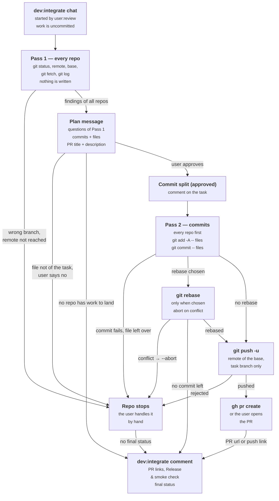

# Integrate — the `dev:integrate` step

Land the reviewed work, after the user approved it in `user:review`. The step commits by an approved split, pushes the task branch and opens a pull request. It never merges: the user merges the pull request (the git rules are in the workflow instructions). It is the last step of the workflow.

## Two passes

Inspect every repo before you write anything in any repo. Then the user approves with all repos in view. In Pass 2, commit (and rebase) in every repo before the first push. So no repo has an open pull request while another repo needs work on its commits.



## Pass 1 — inspect every repo

For each repo of Repos touched and each repo that a `Dev notes:` comment added. Nothing is written.

1. **State.** `git -C <repo> status`. The current branch is `<TAG>-<n>`, and no rebase, merge or cherry-pick is in progress. Otherwise the repo stops.
2. **Files.** `git -C <repo> -c core.quotePath=false status --porcelain -uall`. Each file must be a file of the task: compare with the spec, `Dev notes:`, and the review and test comments. The plan message lists each file that the flow did not touch and asks about it. Never commit an untracked file under `<project folder>/.specs/` (the specs and pages of the research step, of this task and of other tasks), and do not ask about it. Such a file shows only when `.specs/` is not ignored.
3. **Remote.** `git -C <repo> remote`. With exactly one remote, use it. With none or more than one, ask, and show `git -C <repo> remote -v`.
4. **Base.** `git -C <repo> ls-remote --symref <remote> HEAD`. The line `ref: refs/heads/<base>	HEAD` names the base. When the command fails, the repo stops. When it prints no such line, ask.
5. **Fetch.** `git -C <repo> fetch <remote> <base>`. When it fails, or when `<remote>/<base>` does not exist after it (for example in a clone of one other branch), the repo stops.
6. **On the base?** `git -C <repo> log --oneline <remote>/<base>..HEAD`:
   - The list is empty, or it holds only commits of an earlier `Commit split (approved)` comment of this task: the branch is on the base.
   - Other commits: list them and ask the user which they want:
     - **Rebase** onto `<remote>/<base>` in Pass 2. A commit whose change is not on the base stays in the pull request. Offer it only while `git -C <repo> ls-remote <remote> refs/heads/<TAG>-<n>` prints nothing.
     - **PR as it is.** The pull request also shows those commits.
7. **Nothing to land.** No file in item 2 (except the `.specs/` files of that item) and no commit in item 6: the plan message says "nothing to land" for the repo. The repo gets no push and no pull request, and it does not stop.

A repo that **stops** gets no commit, no push and no pull request. The plan message names it and the reason.

Items 5 and 6 need the remote and the base. When you must ask about them (items 3 and 4), ask before the plan message, then continue Pass 1. In all other cases the questions go into the plan message.

## The commit split

**The file list** comes from the working tree, because the work has no commits before this step: item 2 of Pass 1. The commits that the branch already has (item 6) stay as they are, and the plan names them.

**Grouping:**

- Group by part of the change, not by type of file. One commit holds its code, its tests and its fixtures together.
- A commit stands alone only when it can be described alone: a refactor with no change in behavior, a shared test helper, a rename, a change of configuration or dependencies.
- Order: refactor, shared infrastructure, the parts of the feature, the wiring and the UI, the docs. The order is a guide only.
- Size: about 5 to 10 files per commit. A repo with fewer than about 6 changed files gets one commit. A part that really needs 15 files stays one commit.
- At most 6 commits per repo. The limit goes away at 60 or more changed files. Under 60, a change that seems to need a seventh commit lands as 6 larger commits, and the hand-off says that the task was too large to split cleanly.

**Before you show the plan**, apply this table:

| Sign | Fix |
|---|---|
| Two commits with the same description | Merge them |
| A commit with only the tests or the mocks of code in another commit | Merge it back |
| A subject that needs "and" twice to be accurate | Split it |
| A one-file commit that has no meaning alone | Merge it |
| A commit that only reads as "part 2 of 3" | Merge it |

**Messages:**

- **Commit message**: the convention of the repo, from `git -C <repo> log --format=%s -n 20 <remote>/<base>`. When the repo shows no convention: `<type>: <subject>`.
- **PR title**: one line that names the change, with no task id. The task id is local to Tasma, and the branch name has it.
- **PR description**: short. What changes and why, usually 2 sentences. More only when a reviewer would otherwise ask an obvious question.

## The plan message

One message for all repos:

1. The questions of Pass 1 (rebase, files that the flow did not touch), the repos that stopped with the reason, the repos with nothing to land, and the repos that stayed out of Pass 1.
2. For each repo: the commits that the branch already has, each planned commit with its message and its files, the PR title and description, and the rebase choice.

When no repo has work to land (each repo stopped, stayed out of Pass 1 or has nothing to land), do not wait: go to Closing.

Otherwise wait in the same chat. The user approves, or says how to group the files differently, and you show the plan again. When a grouping that the user asks for breaks a rule of the split, say so and propose another grouping, but the choice of the user wins.

A file that the flow did not touch goes into the plan when the user says that it belongs to the task. When the user says no, the repo stops.

This is the pause inside `dev:integrate` of *Human gates* in the workflow instructions. Nothing is committed during the wait, so a chat that stops here leaves the task at `dev:integrate` with no change.

**Record.** Before the first commit, add a comment `Commit split (approved)` with the quote of the approval and, for each repo, the commits with their files, the rebase choice and the PR title and description.

**When the step runs again**, the new chat reads that comment and the earlier `dev:integrate` comment first:

- For each repo that the earlier comment reports as pushed, it finds the state of the pull request: `gh pr view <url> --json state`, when `gh` can be used and the comment has the URL. In all other cases it asks the user. A repo on `<TAG>-<n>` has **nothing new** when item 2 of Pass 1 lists no file (except the `.specs/` files of that item) and `git -C <repo> log --oneline <remote>/<TAG>-<n>..HEAD`, with the remote of item 3, succeeds and prints nothing.
  - **Merged.** On another branch, or with nothing new, the repo landed: it stays out of Pass 1, with no push and no pull request. A squash or rebase merge puts new commits on the base, so `log <remote>/<base>..HEAD` does not show the merge. Otherwise the repo did not land: name what is new, and ask the user whether they want a new pull request from this branch, which also shows the merged commits after a squash or rebase merge. When they do, the repo continues in Pass 1. When they do not, the repo counts as stopped, with the reason "new work after the merge" and its state.
  - **Closed with no merge.** It asks the user whether they want a new pull request. When they do, the repo continues in Pass 1. When they do not, the repo counts as stopped, with the reason "pull request closed" and the state "pushed".
  - **Open.** On another branch, or with nothing new, the repo landed: it stays out of Pass 1, with no push. Otherwise the repo continues in Pass 1.
  - **Not opened yet.** On `<TAG>-<n>`, the repo continues in Pass 1. On another branch the repo landed: it stays out of Pass 1, with no push.
- A repo that the earlier comment reports as "nothing to land" stays out of Pass 1 when its current branch is not `<TAG>-<n>`.
- It keeps the commits that the branch already has.
- When the remaining files match the rest of the approved plan, it continues and does not ask again.
- When they do not match, it plans only the rest and asks again. The new comment names the commits that stay.

## Pass 2 — commit, push, open the pull request

Follow the approved plan exactly. First the commits, the clean-tree check and the rebase in every repo; then the push and the pull request in every repo. So a failure in the commits of one repo comes before any push. When a repo stops before the pushes, push nothing yet: tell the user and ask whether the other repos land now. A repo that the user holds back counts as stopped, with the reason "held back by the user" and the state "committed, not pushed".

**Commits.**

```
git -C <repo> add -A -- '<file>' '<file>' …
git -C <repo> commit -m '<message>' -- '<file>' '<file>' …
```

- Put single quotes around each value in a command: a message, a PR title, a file name, a repo path. Otherwise the shell splits a space, runs a backtick or changes a `$`. Write a `'` in a value as `'\''`.
- Name each file. Never a folder or a pattern: a folder takes every changed file under it, also the files of a later commit.
- A file name with `*`, `?`, `[` or `\` gets the prefix `:(literal)`, for example `':(literal)app/[id]/page.tsx'`. Without it, git reads the name as a pattern, which can match other files.
- `git commit -- <files>` commits only these files, also when other changes are staged.
- `git add` refuses the path of a file that is already staged as deleted or moved (`git rm`, `git mv`). Leave that path out of `git add` and keep it in `git commit`.
- Join the commits of one repo with `&&`, so that a failed commit stops the commits after it. A failed commit stops the repo.

**Clean tree.** After the last commit, the command of Pass 1 item 2 prints nothing, except the files under `.specs/` of that item. A file that is left means that the plan missed it: name it, and the repo stops before the push. Never put left files into a catch-all commit. A second run of the step plans the left file as the rest of the work.

**Rebase**, only when the user chose it and `git -C <repo> ls-remote <remote> refs/heads/<TAG>-<n>` prints nothing; otherwise skip the rebase. Run `git -C <repo> rebase <remote>/<base>`, while the tree is clean. On a conflict or an error, `git -C <repo> rebase --abort`: the branch and its commits come back as they were, the repo stops, and no pull request opens. After a rebase, show `git -C <repo> log --oneline <remote>/<base>..HEAD`. When the list is empty, the repo has nothing to land: no push and no pull request.

The rebase comes after the commits: a conflict then stops on one commit with its own files, and `--abort` restores the branch exactly. Before the commits, the work is only in the working tree, and a failed rebase can leave all of it as conflict markers.

**Push.** `git -C <repo> push -u <remote> <TAG>-<n>`. When the remote rejects the push, the repo stops.

**Pull request.**

- Use `gh` when `command -v gh` succeeds, `gh auth status` succeeds, and the repo has exactly one remote. With more than one remote, `gh` can open the pull request in the wrong repository, for example the upstream of a fork.
- In the repo folder: `gh pr create --base <base> --head <TAG>-<n> --title '<title>' --body-file -`, with the description on standard input, from a quoted heredoc.
- When a pull request for the branch is already open, `gh pr create` fails and prints its URL. Use that URL: the push has already updated that pull request.
- In all other cases (no `gh`, not logged in, more than one remote, another failure of `gh`) the user opens the pull request. Give the link that the host printed on push (the `remote:` lines), or the address of the remote without its user part (`user:token@`) and "from `<TAG>-<n>` to `<base>`", and the approved title and description.

## Closing

**The `dev:integrate` comment.** The same text goes in the chat:

1. For each repo: the commits (short SHA and message), and the PR URL, or "PR not opened: <reason>" with the link to open it.
2. The release block, from the section Release & smoke check of the spec:

   ```
   ## Release & smoke check
   RELEASE:
   - review and merge the PR: <url>
   - open the PR from <TAG>-<n> to <base>: <link>
   - <repo> → <deploy target>
   SMOKE TEST (basics):
   - <2 to 4 checks from the spec>
   ```

   The "open the PR" line shows only for a pull request that is not opened yet, and the "review and merge" line only for a pull request that is open.

**All repos landed.** A repo that did not stop landed when its pull request is open or merged, when its branch is pushed and the user opens the pull request, or when it has nothing to land.

- Set a final status of the project that means "completed", not "cancelled". The step stays `dev:integrate`.
- No next chat: the workflow has no next step.
- `# REQUIRED FROM USER`: open each pull request that is not opened yet (the link, the title and the description), review and merge each pull request that has not merged, then run the smoke checks of the release block.
- When a pull request shows commits that are not of this task, the hand-off names them.

**Some repos stopped:**

- The comment tells what landed, and for each repo that stopped, the reason and its state: committed or not, pushed or not.
- The step stays `dev:integrate`, and the status stays the work-in-progress status.
- `# REQUIRED FROM USER` names each repo that stopped and why. The user fixes it by hand, then sets the final status or runs the step again. A second run keeps the commits that exist and opens no second pull request, unless the user asks for it.

**Hand-off.** When all repos landed: `# ✅ Done: dev:integrate → <final status>`, then `not started: the workflow has no next step`. When some repos stopped, the first header is `# Stopped: dev:integrate`, not `# ✅ Done`, because the step is not complete, then `not started: some repos stopped`.
