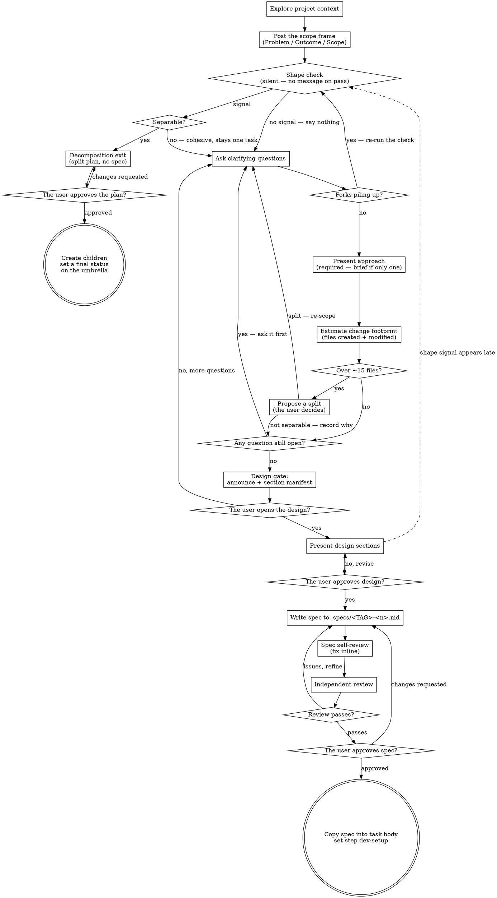

# Research — the `dev:research` step

Turn a task idea into a fully formed spec through a natural, collaborative dialogue with the user. Then — **only on their explicit approval** — save the spec into the task body and advance to `dev:setup`.

Start by understanding the current project context, then ask questions one at a time to refine the idea. When you understand what you are building, present the design and get the user's approval.

## Two Exits

`dev:research` has one entry and **two** terminal states.

- **Spec exit** (the default; the Checklist below describes it) — the task is one task. Deliverable: a spec. Terminal state: `dev:setup`.
- **Decomposition exit** — the task is an umbrella over several separable tasks. Deliverable: a **split plan, not a spec**. Terminal state: the children are created and the umbrella closes. See [The Decomposition Exit](#the-decomposition-exit).

The route between them is the **shape check**, a silent test described below. A task whose body already declares it an umbrella (its stated deliverable *is* a split) enters the decomposition exit directly and skips the check.

<HARD-GATE>
Research is READ-ONLY. Do NOT write code, create branches, run any mutating git command, or take any implementation action — produce only the spec (or, on the decomposition exit, the split plan). In the project folder, the step writes files only in `.specs/`. Do NOT advance past the user's approval. This applies to EVERY task, however simple it looks.

Never describe the design as "locked", "final", "settled" or "approved", and never begin to write the spec, on your own initiative. While the user is asking questions or pushing back, you are on the flow's **"no, revise"** arc by definition — stay there until they explicitly say otherwise.
</HARD-GATE>

## Anti-Pattern: "This Is Too Simple To Need A Design"

Every task goes through this process. A todo list, a single-function utility, a config change — all of them. "Simple" tasks are where unexamined assumptions cause the most wasted work. The design can be short (a few sentences for a truly simple task), but you MUST present it and get approval.

## Checklist

This is the **Spec exit** checklist. Create a todo for each of these items and complete them in order — but the shape check at item 3 can divert the whole run to [The Decomposition Exit](#the-decomposition-exit), which has its own, much shorter list.

1. **Explore project context** — read files, docs, recent commits (read-only). Exploration finishes before the first message to the user — see *Understanding the idea* below.
2. **Post the scope frame** — three lines (Problem / Outcome / Scope), before any clarifying question. See *The Scope Frame* below.
3. **Shape check** — one task, or an umbrella over several? A **silent** test: it shows nothing unless it trips, and it fires again while the questions run. See *The Shape Check* below.
4. **Show, do not only tell** — when a picture helps, show it. See [Visuals](#visuals).
5. **Ask clarifying questions** — one at a time, **one decision per question**. Understand purpose, constraints and success criteria. Never bundle several decisions into one question, and never presuppose a decision that is not made inside the framing of a question. Ask only what you really need; if the task is already clear, do not make up questions — skip ahead.
6. **Propose approaches** — **REQUIRED, never skip** (even when there is exactly one obvious way — then it is a few sentences that name what you will build and which way; see the Anti-Pattern above). Only the really viable ones; never pad to a count with unrealistic or unrelated alternatives. Give the trade-offs and your recommendation.
7. **Estimate the change footprint** — **REQUIRED, never skip.** Count the files that the chosen approach will create or modify, across every repo. Over ~15 → propose a split before any design section. See *Estimating the Change Footprint* below.
8. **Open the design gate** — resolve every open question and present the approach first, then post a standalone gate message (questions are done + the numbered section manifest) and wait. No design section is presented before this. See *The Design Gate* below.
9. **Present design** — **REQUIRED, never skip** (even for a trivial task — the design can be just a few sentences, but it MUST be presented and approved; see the Anti-Pattern above). Present it **one section per message — never the whole design at once**, and get the user's read on each before the next.
10. **Write the spec** — save it as a local file at `<project folder>/.specs/<TAG>-<n>.md` (no git). Before a new file in `.specs/`, write the `.gitignore` or run the ignore check — see *The spec file* in the workflow instructions. The spec MUST include a **Repos touched** section and a **Release & smoke check** section. A diagram in the spec is optional: add one where it helps a reader. Tasma draws Mermaid in the task body.
11. **Spec self-review** — a quick inline check for placeholders, contradictions, ambiguity, scope (see below)
12. **Independent review** — run the spec reviewer, plus the accessibility reviewer when the spec specifies user-facing UI; refine until they pass (see below)
13. **The user reviews the spec** — present it open-ended and let the user read, ask, and request changes; loop until they explicitly approve
14. **On approval** — copy the spec into the task body and set the step to `dev:setup` (no plan, no branch, no code)

## Process Flow



**The terminal state of the Spec exit is `dev:setup`.** It produces a spec and nothing else: no code, no branches, no mutating git, and no implementation plan (this workflow has no plan phase). The single gate that ends research is the user's explicit spec approval — see *Human checkpoints are conversations* in the workflow instructions. Implementation begins later, in a separate `dev:implement` chat.

**The other terminal state belongs to [The Decomposition Exit](#the-decomposition-exit)**: the umbrella never reaches `dev:setup` — on approval the children are created and the umbrella gets a final status.

## The Process

**Understanding the idea:**

- Check the current project state first (files, docs, recent commits)
- **Exploration finishes before any message to the user.** Wait until every subagent has reported. Do not post the scope frame or ask a question while a subagent is still running.
- Post the scope frame, then run the shape check (both below), **before** the first clarifying question. Scope is settled first, details second — questions spent on a scope that is about to be decomposed are wasted. Do not post notes after the scope frame: it is the last message before the user answers.
- For a task of the right scope, ask questions one at a time to refine the idea
- Prefer multiple-choice questions when possible, but open-ended questions are fine too
- Only one question per message — if a topic needs more exploration, break it into more questions
- Focus on understanding: purpose, constraints, success criteria
- Ask only what you really need answered — if nothing is unclear, say so and move on; do not make up questions to fill the step

**The Scope Frame — the first thing posted, before any question:**

You cannot ask useful questions about a scope that nobody has stated. Post the frame before the first clarifying question — three lines, nothing else:

**Problem**:  <what is wrong today>
**Outcome**:  Done when <one sentence>
**Scope**: <bullets>

- **`Outcome` is one sentence, and it must be writable.** If you cannot finish "Done when …" in a single sentence, that is itself the first shape-check signal — do not pad it with "and" to make it fit.
- **`Scope` bullets are outcomes, in the user's terms** — what the work covers, not the implementation steps that deliver it.
- **It is a proposal, not a summary.** Where the task body is silent, state what you assume, so the user can correct it in one reply. The corrected frame is what the rest of research works from.
- **A picture of the current state can go under the frame, as one link line.** When a picture of the current state helps, make its page (see [Visuals](#visuals)) before you post the frame, and add `Current state: <link>` as a fourth line. This is the only addition the frame allows.
- **It stays in the chat.** Like the estimate of how many files will change, the frame is used only during research — it is never written into the spec or the task.

**The Shape Check — silent unless it trips:**

One task, or an umbrella over several? This is a **test, not a step**. It is never announced, and a pass produces **no message at all**. On a one-file change it adds no turns: the frame is already on screen, the check reads it, finds nothing, and the questions begin.

It fires twice:

1. **At the frame**, on the three lines alone. Signals: more than one independently valuable outcome; no writable single "Done when" sentence; a `Scope` bullet that could ship on its own and be used.
2. **While the questions run** — the firing that matters most. Signals: three or more open decision forks have accumulated; or the answer to one question changes which of the other questions still make sense. Run the check again whenever either happens, however deep into the questions you already are.

**A signal is not a verdict.** A trip only obliges you to test **separability** per *Split a task* in the tasma skill: each piece must have independent value, be able to land on its own, or be a clean dependency of another. A large but cohesive change — a rename, a framework revert, one feature that cannot land in halves — trips signals and correctly **stays one task**.

- **Separable → stop and take [The Decomposition Exit](#the-decomposition-exit).** Name the pieces and why, and ask no further detail question and present no further design section until the shape is settled.
- **Not separable → say nothing** and continue the Spec exit. Do not narrate the check, and do not report that you ran it.
- **Work already spent is not a reason to continue.** The check is valid at any point, including after the design gate and after design approval. Design sections discarded now cost less than a spec that has to be split again during development.

**Exploring approaches:**

- **This step is required and never skipped.** Questions scale down to nothing when the task is already clear; an approach does not. It is always presented before the design gate, also when the task is straightforward and there is exactly one obvious way to do it. Certainty about the approach is not a reason to skip it; it is what makes it cheap to state.
- **Scale the message to the task, never to zero.** One obvious approach gets a brief message: what will be built, which way you intend to build it (the mechanism, where the code lives, what it reuses), and anything it deliberately will not do. A few sentences — no trade-off table, no invented alternatives, no restatement of the task. Several real options get the full comparison.
- Propose the really viable approaches (often there is just one) with trade-offs — do not invent unrealistic or unrelated alternatives just to reach a count of 2-3
- Present the options conversationally, with your recommendation and reasoning
- Lead with your recommended option and explain why
- **Then stop and let the user react.** This is their first look at the shape of the work and the cheapest point to change its direction — the design gate comes after, in a separate message.

**Estimating the change footprint — after the approach, before the design gate:**

The approach is the first point where the size of the diff is knowable, and research is the only step that can still change it. When the design is approved, the diff exists as specified, and an oversized diff is worked around, not made smaller.

- **Count the files.** For the recommended approach, count the git-tracked files that it will **create or modify** — source, helper files, type files, tests, styles, fixtures, docs, additional files — across **every** repo in *Repos touched*.
- **The threshold is ~15 files.** At or under it, state the number in one line and move to the design gate. Over it, **stop and raise it before you present any design section.**
- **Over the threshold, propose a split.** Say the estimated count, name what drives it (which subsystems, which repos), and propose the split per *Split a task* in the tasma skill. Split on **separability, not size**: each piece must have independent value, land on its own, or be a clean dependency of another.
- **Not everything large is splittable, and that is a valid answer.** A mechanical, repetitive change (a rename, a dependency bump, a framework revert) touches many files and holds one decision — it stays one task. A single cohesive feature that cannot land in halves stays one task too. When the count is over the threshold and the work is not separable, **say so explicitly with the reason** and proceed.
- **Splits are created on the user's spec approval, not before.**
- **The estimate lives in the chat, not in the spec.** It is a research-time check on scope, not a deliverable — say it, act on it, and let it go. Nothing about the count is written into the spec or the task.

**The Design Gate — before section 1:**

Design sections do not begin until the questions are done. The gate makes the phase change visible in the chat, so the user always knows if they are being asked or being shown.

- **The approach comes first.** The gate is not posted until the approach has been presented on its own and the user has reacted to it. A design gate is never the first thing the user hears about how the task will be built, however simple the task looks.
- **The change footprint is settled first too.** If the estimate is over ~15 files and the split question is still open, the gate is not posted — a re-scope after the design is approved wastes the whole design.
- **Clarify first, present second.** If you hold *any* unanswered question about what you are building, you are still in the questions step — do not present a design section. Ask the question, get the answer, and only then move on.
- This bans **carrying a known, unasked question into a design section** — it does not ban a question that really comes up later, during the design or even after approval. Ask those when they come up.
- **Post the gate message on its own.** When nothing is left open, send one short standalone message with three parts:
  1. A plain statement that the questions are done.
  2. The **section manifest** — the numbered titles of every section you intend to present, so the user sees the whole map first and can tell when a later message does not match its slot.
  3. An explicit offer to stay in questions instead.
- **Then wait.** The user either opens the design or keeps asking. **Do NOT include the content of section 1 in the gate message** — the manifest names titles; the content of a section is a separate message.

```
Questions are done — nothing open on my side.

The design has 4 sections:
  1. Architecture
  2. Data flow
  3. Error handling
  4. Testing

Say go and I'll send section 1 on its own. If you'd rather keep asking, we stay in questions.
```

**Presenting the design:**

- **This step is required and never skipped** — unlike questions and approaches (which scale down when the task is clear), the design is always presented and approved, even if it is only a few sentences.
- Sections start only after the Design Gate above has been posted and the user has opened the design
- **Present the design in sections, ONE section per message — never deliver the whole design in a single message.** Scale each section to its complexity (a few sentences if straightforward, up to 200-300 words if nuanced). After each, STOP and get the user's read before you send the next. To name what a later section will cover is fine; to present the content of that section early is not.
- Cover: architecture, components, data flow, error handling, testing
- **New UI: a mockup is recommended.** The section that describes a new screen, or a new part of an existing screen, can show its mockup on a page (see [Visuals](#visuals)), or link the original design source when one exists.
- Be ready to go back and clarify if something does not make sense
- **Design approval is the user's to give, and must be quoted — never inferred.** The design phase ends only when the user explicitly says that the design is good, in their own words (words you could quote back). Answers to your questions, an option picked in a prompt, or your own conviction that every fork is resolved are **not** approval. While the user is still asking questions or pushing back, you are on the flow's **"no, revise"** arc — keep iterating: do **not** call the design "locked", "settled" or "done", and do **not** move on to write the spec, until they give that explicit go-ahead.

**Design for isolation and clarity:**

- Break the system into smaller units that each have one clear purpose, communicate through well-defined interfaces, and can be understood and tested independently
- For each unit, you should be able to answer: what does it do, how do you use it, and what does it depend on?
- Can someone understand what a unit does without reading its internals? Can you change the internals without breaking the consumers? If not, the boundaries need work.
- Smaller, well-bounded units are also easier for you to work with — you reason better about code that you can hold in context at once, and your edits are more reliable when files are focused. When a file grows large, that is often a signal that it does too much.

**Working in existing codebases:**

- Explore the current structure before you propose changes. Follow existing patterns.
- Where existing code has problems that affect the work (for example a file that has grown too large, unclear boundaries, tangled responsibilities), include targeted improvements as part of the design — the way a good developer improves the code they work in.
- Do not propose unrelated refactoring. Stay focused on what serves the current goal.

## After the Design

**Documentation:**

- Write the validated spec to `<project folder>/.specs/<TAG>-<n>.md` — the `.specs/` folder in the project folder. Before a new file in `.specs/`, write the `.gitignore` or run the ignore check — see *The spec file* in the workflow instructions.
- The spec MUST include a **Repos touched** section — the authoritative list of repos that will each get a `<TAG>-<n>` branch at `dev:setup`.
- **A diagram in the spec is optional.** Add one where it helps a reader of the spec, inside the section that it explains. Tasma draws Mermaid in the task body.
- The spec MUST include a **Release & smoke check** section — the RELEASE plan (which repos get pushed, where each deploys) and 2–4 SMOKE TEST basics that prove that the feature works in production (for example "the main flow of the feature completes end-to-end without errors"). Write it now, while the context is fresh; `dev:integrate` later turns it into the release checklist. Keep the smoke checks to basics, not a full test script. See *Communication between chats* in the workflow instructions.
- Write clearly and concisely.
- Do NOT commit anything — research is read-only. The spec stays a local file and is copied into the task body only on the user's approval.

**Spec Self-Review:**
After you write the spec, look at it with fresh eyes:

1. **Placeholder scan:** Any "TBD", "TODO", incomplete sections, or vague requirements? Fix them.
2. **Internal consistency:** Do any sections contradict each other? Does the architecture match the feature descriptions?
3. **Scope check:** Is this focused enough for a single task, or does it need decomposition? Count again the files that the written spec implies — a design that grew past the earlier estimate is a missed split candidate.
4. **Ambiguity check:** Could any requirement be interpreted in two different ways? If so, pick one and make it explicit.
5. **Diagram check** (only when the spec has diagrams): each diagram agrees with the text around it.

Fix any issues inline, then start the independent review below.

**Independent Spec Review:**
After the self-review, the spec gets an independent review before the user sees it; research is not self-approved. The reviewers run as **subagents in parallel**, at top level (see *Model levels of review subagents* in the workflow instructions), because this is the last correctness gate before the user sees the spec.

- **Spec reviewer** — always runs.
- **Accessibility reviewer** — runs whenever the spec specifies user-facing UI: a new view, screen, dialog, panel, form or control, or a change to an existing one. A pure backend, CLI, data or infrastructure spec skips it.

When the agent cannot start subagents, it runs each review as a separate pass after the self-review: it reads the spec again from the start against the reviewer prompt, and it says in the chat that the review was not independent.

Give the spec reviewer a prompt along these lines:

> You are a spec document reviewer. Verify that this spec is complete, consistent, and ready for the development phase.
>
> **Spec to review:** `<project folder>/.specs/<TAG>-<n>.md`
>
> Check:
> - **Completeness** — TODOs, placeholders, "TBD", incomplete sections
> - **Consistency** — internal contradictions, conflicting requirements
> - **Clarity** — any requirement ambiguous enough to make someone build the wrong thing
> - **Scope** — focused enough for one task, not multiple independent subsystems; if separable, say so
> - **Repos touched** — section present and plausible
> - **Diagrams** (if any) — each diagram agrees with the text of its section
> - **Release & smoke check** — section present: a RELEASE plan (repos to push + deploy target) and 2–4 SMOKE TEST basics
> - **YAGNI** — unrequested features, over-engineering
>
> Only flag issues that would cause real problems during the development phase. Minor wording or style preferences are not issues. Approve unless there are serious gaps that would lead to a flawed implementation.
>
> Output:
> **Status:** Approved | Issues Found
> **Issues (if any):** [Section] — [specific issue] — [why it matters]
> **Recommendations (advisory, do not block approval):** [suggestions]

**Accessibility Spec Review (user-facing UI only):**
Runs beside the spec reviewer, never instead of it. Give it a prompt along these lines:

> You are an accessibility reviewer for a spec document, not for code. Verify that the spec settles the accessibility questions that must be decided before implementation starts.
>
> **Spec to review:** `<project folder>/.specs/<TAG>-<n>.md`
>
> Check every user-facing element that the spec introduces or changes:
> - **Keyboard model** — is every action reachable and operable without a pointer? Are the keys named for custom widgets (menus, trees, canvases)? If a single character is a shortcut, can it be turned off, remapped, or scoped to the focused component?
> - **Focus management** — where does focus go when a view, dialog or panel opens, closes, or has its content replaced? Is it trapped where it must be?
> - **Pointer and drag** — does any action need a drag, swipe or path gesture? Name the single-pointer, non-dragging way to do the same thing; a keyboard equivalent does not satisfy this. Are targets at least 24x24 CSS px, or spaced that far apart?
> - **Semantics** — does a native element do the job, or is a custom widget required? For each custom one, name the pattern that it follows and the accessible name that an icon-only control exposes.
> - **State without color** — does every state that the spec names (selected, error, active, drop target) carry a second cue beyond color?
> - **Dynamic content** — which async events must interrupt a screen reader user, and which must not? If a list loads more as the user scrolls, how does a keyboard user reach what comes after it?
> - **Forms** — are labels, required/optional status, and error text tied to the field that failed? In a multi-step flow, does any step ask again for what an earlier step already collected?
> - **Timing and motion** — does anything animate, auto-advance, auto-refresh, or expire? Name the pause, extend or turn-off path, and the warning that comes before work is lost.
> - **Destructive actions** — for any action that deletes, overwrites or commits: is it reversible, checked before it runs, or confirmed in a review step? Pick one.
> - **Authored alternatives** — does this add a chart, diagram, canvas or video? Name who writes the long description, captions or transcript, and where that text lives.
>
> Flag only what the spec itself must decide. Implementation detail that an engineer settles correctly by default is not an issue, and neither is a rule that the design system of the project already enforces. If the spec specifies no user-facing UI, say so and approve.
>
> Output:
> **Status:** Approved | Not applicable | Issues Found
> **Issues (if any):** [Section] — [what is undecided or wrong] — [who it locks out]
> **Recommendations (advisory, do not block approval):** [suggestions]

If either reviewer finds issues, refine the spec and review again until both pass — a change made for one can break what the other already cleared. Only then show the spec to the user.

**The User's Review (the gate that ends research):**
When the independent review passes, present the spec to the user. Keep it **open-ended**: show the spec, tell where it is (`<project folder>/.specs/<TAG>-<n>.md`), and wait. Let the user read it, ask questions, push back, or request changes in their own words. Do **NOT** drive this with a forced-choice prompt — see *Human checkpoints are conversations* in the workflow instructions.

Loop — make any requested changes and run the self-review and the independent review again — until the user **explicitly approves**.

**On the User's Approval:**

- **Approval must be quoted, not inferred.** If you cannot quote an explicit approval, it has not happened — stay in the loop. Answers to your questions, an option picked in a prompt, or your own conviction that the design is complete are **not** approval.
- Copy the approved spec into the task body — it becomes the source of truth from then on; keep the local `<project folder>/.specs/<TAG>-<n>.md` in sync.
- Set the task step to `dev:setup`.
- Do NOT create branches or write code — branches are created at `dev:setup`, in a separate chat. This workflow has no plan phase, so no implementation plan is produced.

## The Decomposition Exit

Taken when the shape check finds that the task is really several separable tasks, or when the body of the task already declares it an umbrella (its stated deliverable *is* a split). **The deliverable is a split plan, not a spec.** Nothing that follows the shape check on the Spec exit applies here, and none of it is produced: approaches, the file-count estimate, the design gate, design sections, `Repos touched`, `Release & smoke check`. Research stays READ-ONLY exactly as before.

Replace the remaining todos of the Spec exit with these:

1. **Post the seams and the locked list** — one message, then wait. See *The gate before the plan is written*.
2. **Write the split plan** — to `<project folder>/.specs/<TAG>-<n>.md`, with the six sections below. Before a new file in `.specs/`, write the `.gitignore` or run the ignore check — see *The spec file* in the workflow instructions.
3. **Self-review**, then **independent review** — refine until it passes.
4. **The user reviews the plan** — open-ended; loop until they explicitly approve.
5. **On approval** — copy the plan into the body, create the children, set a final status on the umbrella.

### The rule that keeps this cheap

> **Do not research the children deeply, and do not ask the user child-level questions. Each child runs its own `dev:research`.**

An unanswered decision is not a gap in the plan — it is the work of the child. Write it on the **Key research questions** line of that child and leave it unanswered.

- **Lock only what two or more children would otherwise decide inconsistently** — a shared data model, a wire contract, a naming rule, the repo layout. If exactly one child cares about a decision, it belongs to that child, not to you.
- **A question to the user is allowed only when the answer moves the seam** — which piece owns what, or what two children must agree on. That is the own work of the decomposition. Everything that a single child owns is out of limits, even while the context is loaded and the answer seems easy to settle.
- **Reading depth follows the same line.** Read enough of the codebase to place the seams; never read into the subsystem of a child in order to design it.

### Locked decisions must be traceable

`Locked decisions` binds **every child, permanently**. No child opens it again: the card says locked, so the own `dev:research` of each child treats it as given. A decision that the AI only concluded therefore becomes an architectural constraint across N tasks that nobody ever revisits — and after approval there is no way to tell it apart from one that the user actually made. The standard that this flow already applies to approval applies to every decision:

> **A locked decision must be quotable to the user.** If you cannot point at where they decided it, it is not locked.

Anything else has exactly two legal homes:

- **Working assumption** — the best guess of the AI, written as such, naming the **one child that settles it**. That child is free to overturn it.
- **A question** — asked now, but only when the answer moves a seam (see the rule above). Otherwise it is a working assumption.

Two places where the same freezing happens without the word "locked", held to the same standard:

- **A `Scope` bullet that resolves an open fork is a hidden locked decision.** "Reads through the daemon API, no private paths" binds the child exactly as hard as the locked list does. Either it is quotable to the user, or it is written as a *Key research question* of that child instead.
- **`Deferred decisions` records only what was left open**, so it is no evidence about what was closed. The locked list alone carries that burden — which is why every entry names its source.

### The gate before the plan is written

The plan is not written directly after the shape check trips. The user sees the two things worth redirecting **first**, in one message, and the plan is written only when they have reacted:

1. **The seams** — the child titles, one line each on what the child delivers, and the dependency order.
2. **The locked list, with sources** — every decision about to be frozen for all children, each with where the user decided it. An empty list is a valid and common answer; state it explicitly, do not omit the part.

Then wait. The user moves a seam, merges two children, or strikes a locked decision. **One message, not a section-by-section walk** — the cards are shallow by rule, so there is no depth to reveal step by step.

### The split plan

While research runs, the plan is a local file at `<project folder>/.specs/<TAG>-<n>.md`. That is the same scratch location that the Spec exit uses, for the same reason: the user and the reviewer read the document there before it is approved. It is not committed, and it is not a spec — only the file location is shared. On approval it is copied into the body of the umbrella.

Sections:

1. **Goal** — what the umbrella is for, plus the explicit statement that it produces no code: the deliverables are this plan and the N tasks created on approval.
2. **Locked decisions** — the cross-cutting ones only, **each naming where the user decided it**, per the rules above. Everything else goes in a separate *working assumptions* list, each naming the one child that settles it.
3. **Child cards** — one per child: **Goal**, **Scope**, **Key research questions** (the deliberately unanswered ones), **Deliverable**, **Depends on**. Group them into waves when the order matters.
4. **Statuses** — the child that is next → the ready status; every other → the not-ready status, so each gets its own `dev:research`. Never push an unclear child directly to the ready status; that lets it skip its own spec gate.
5. **Deferred decisions** — a table of *decision → owner child*. This is the proof that the rule above was followed: every question that this research declined to answer is visible, and has a home.
6. **Out of scope** — pieces deliberately not created as tasks, named so that they are not lost.

### Review and approval

The same two gates as the Spec exit, with a brief specific to the decomposition:

- **Self-review** — is any child still an umbrella? Does every locked decision name a source in the user's words? Does any locked decision belong to a single child? Does any `Scope` bullet resolve a fork that should be the question of the child? Are the dependencies acyclic?
- **Independent review** — as under *Independent Spec Review* above, at top level, with one reviewer only — a split plan specifies no UI, so the accessibility reviewer does not run here. Ask it to check **authority** (does every locked decision name where the user decided it, and is anything frozen on the AI's say-so — also inside a `Scope` bullet), **separability** (could each child land alone and be worth having), **leakage** (decisions locked here that one child owns; questions answered here that belong to a child), **coverage** (does the union of the children equal the scope of the umbrella, with nothing lost), **residual umbrellas** (a child still too large to research as one task), and **dependency sanity**.
- **The user's approval** — open-ended, exactly as for a spec: show the plan, tell where it is, and wait. Never inferred, always quotable.

### On approval

- Copy the plan into the body of the umbrella task.
- Create the children per the plan — statuses, priorities, dependencies, and the `Split from <TAG>-<n>` relation line — and change every cross-reference inside a card to the real task id.
- **Set a final status on the umbrella.** It never reaches `dev:setup`: there is no development phase, and to create the children *is* the work.

## Key Principles

- **Shape before depth** — Frame the scope in three lines, settle one task or umbrella, and only then spend questions on detail; settle it again whenever decision forks pile up
- **One question at a time** — Do not overwhelm with multiple questions
- **Multiple choice preferred** — Easier to answer than open-ended when possible
- **YAGNI** — Remove unnecessary features from all designs
- **Always name the approach** — Present it before the design gate every time, brief when there is only one obvious way — real options only, never padding to a count
- **Size the diff before you design it** — Estimate the files created + modified, raise anything over ~15 as a split candidate, and never re-scope after the design is approved
- **Show, do not only tell** — When a picture helps, show it
- **Incremental validation** — Present the design, get approval before moving on
- **Be flexible** — Go back and clarify when something does not make sense

## Visuals

**Show, do not only tell.** A picture often explains better than text: a flow, states, how parts connect, the difference between options, or a new screen. When a picture helps the user understand or choose, show one. You choose the form, for example a Mermaid diagram or an HTML mockup.

**Pages.** Put each picture on an HTML page in `<project folder>/.specs/<TAG>-<n>/`. Before a new page, write the `.gitignore` or run the ignore check — see *The spec file* in the workflow instructions. Serve the folder of the task:

```sh
python3 -u -m http.server 0 --bind 127.0.0.1 --directory <that folder>
```

- Give the link `http://127.0.0.1:<port>/<page>` in the chat. The first output line of the server gives the port.
- Before you give a link, check that the server answers, for example with `curl`. Tasma stops the agent, and the server with it, after a pause. When the server does not answer, start it again and give the new link.
- Stop the server at the end of the step.
- Without `python3`, or when the server does not start, show a diagram in the chat as a Mermaid block, and describe a mockup in text.
- A page can load a library, for example mermaid.js, from a CDN. The content of the page stays on the machine: never paste it into a hosted service.

**In the spec.** Add a Mermaid diagram when it helps a reader of the spec. Tasma draws Mermaid in the task body.
